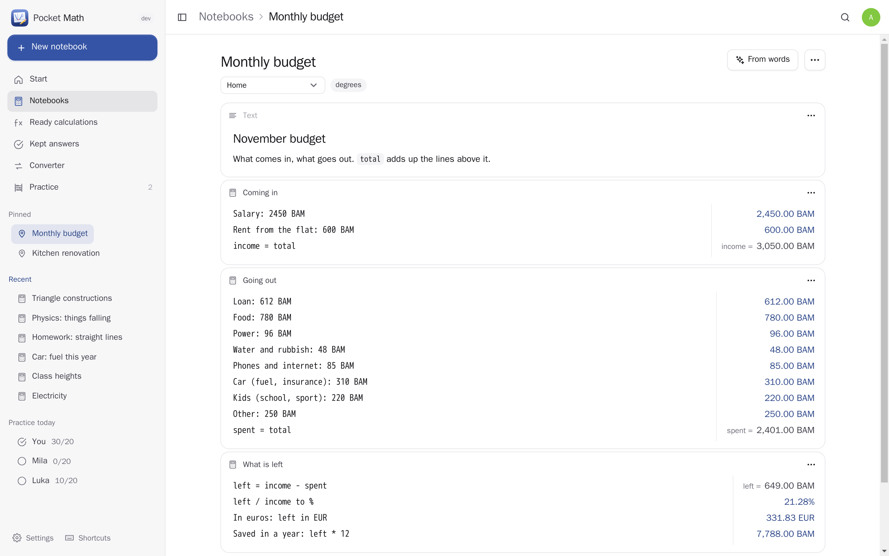
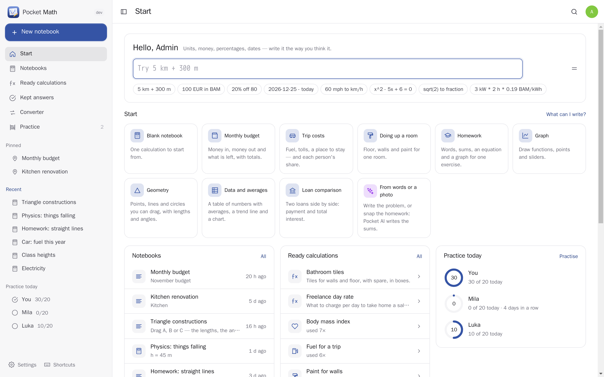
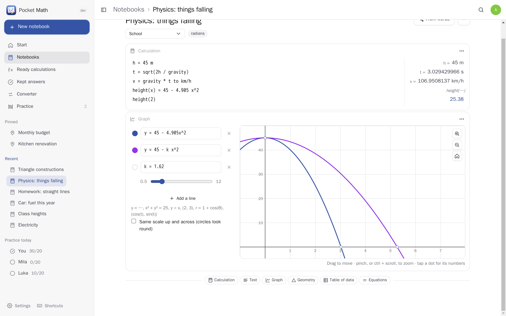
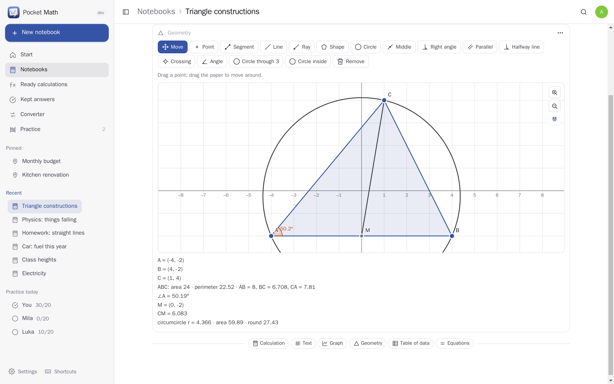
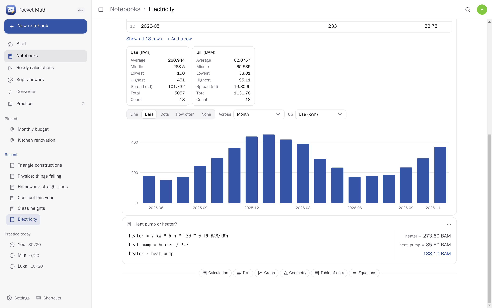
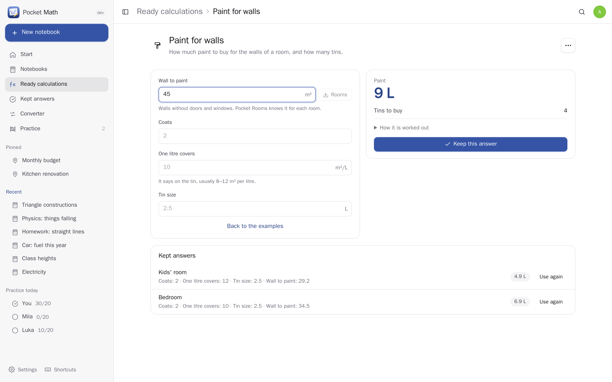
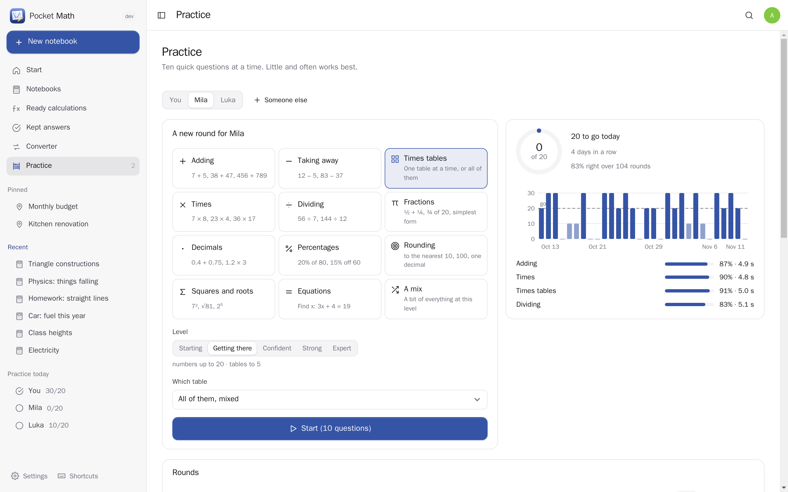
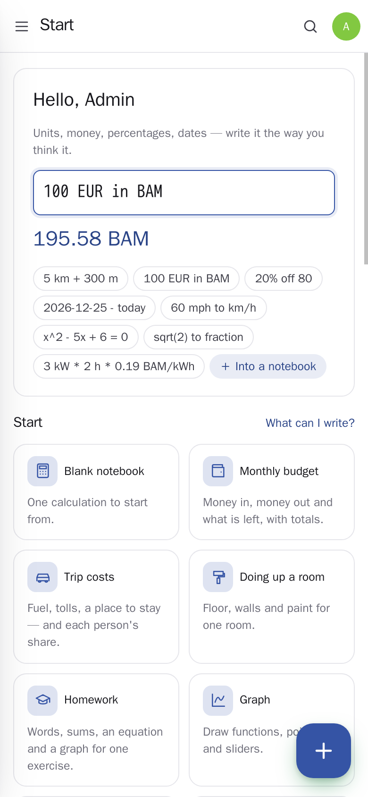
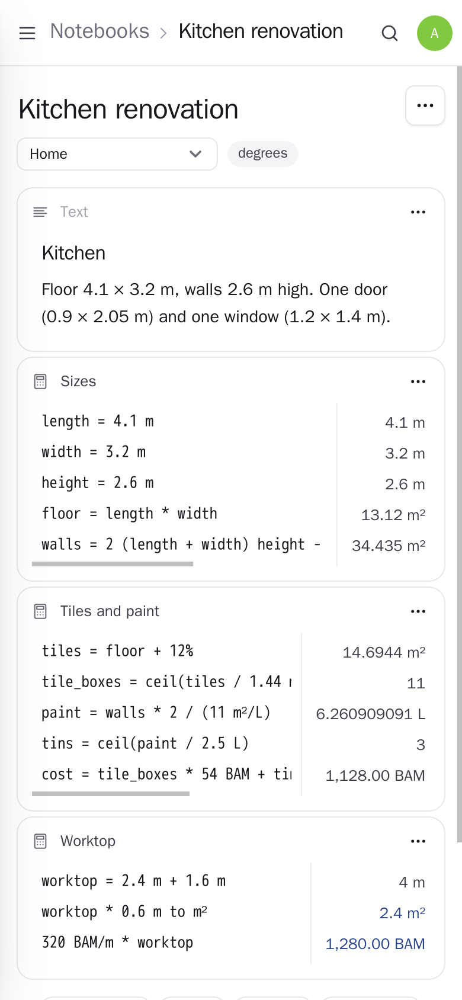
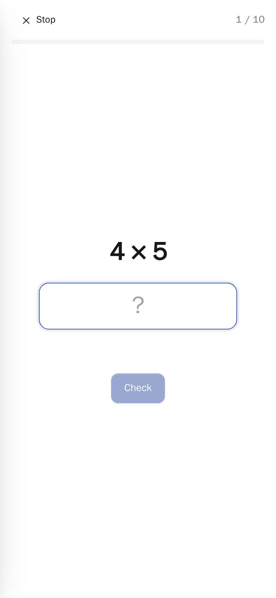

<p align="center"></p>

<h1 align="center">Pocket Math</h1>

<p align="center">Maths for everyday life and school, on your own server: write sums the way you think them — with units, money, percentages and dates (<code>5 km + 300 m</code>, <code>100 EUR in BAM</code>, <code>20% off 80</code>, <code>today + 3 weeks</code>) — and see each answer beside its line. Notebooks also hold graphs with sliders, geometry you can drag, tables of data with averages and trend lines, and equations solved for you. Ready calculations for paint, flooring, loans, savings, fuel for a trip, BMI and more than thirty others fill themselves in from your other Pocket apps; children practise times tables and sums. Replaces Soulver/Numi, the Desmos and GeoGebra basics, a pile of online calculators and the times-tables app.<br>One Go binary, one SQLite file, one volume. Part of the Pocket apps; works on its own too.</p>

<p align="center">
  <a href="https://github.com/abjelosevic88/pocket-homelab-math/actions/workflows/ci.yml"></a>
  <a href="https://github.com/abjelosevic88/pocket-homelab-math/pkgs/container/pocket-homelab-math"></a>
  <a href="LICENSE"></a>
</p>

<p align="center"></p>

<table>
  <tr>
    <td width="50%"></td>
    <td width="50%"></td>
  </tr>
  <tr>
    <td width="50%"></td>
    <td width="50%"></td>
  </tr>
  <tr>
    <td width="50%"></td>
    <td width="50%"></td>
  </tr>
</table>

<table>
  <tr>
    <td width="33%"></td>
    <td width="33%"></td>
    <td width="33%"></td>
  </tr>
</table>

## What it does

- **Sums as you think them.** One sum per line, the answer beside it as you type. Units of length, weight, area, volume, speed, time, energy, power, pressure, data, temperature and fuel use (`60 mph to km/h`, `6.5 L/100km to mpg`, `2 h 30 min to min`, `3 kW * 2 h * 0.19 BAM/kWh`); money in 30+ currencies with the European Central Bank's rates (`100 EUR in BAM`, `$20 + €15`); percentages (`50 + 10%`, `10% off 80`); dates (`2026-12-25 - today`); names (`price = 12.5 EUR`) and functions (`f(x) = x^2`, `f'(3)`) used on the lines below and in the cells below; labels (`Rent: 450 EUR`) and `total`; fractions beside decimals (`= 1/3`); hex, binary and scientific; statistics, loans and compound interest.
- **Notebooks.** Cells of calculations, words (headings, lists, `$x^2$`), graphs, geometry, tables of data and equations, in folders, with starts for a budget, a trip, doing up a room, homework, a graph, geometry, data or comparing loans. Autosaved; share a read-only link, print, download as Markdown.
- **Graphs.** `y = …`, `x = …`, `x² + y² = 25`, `y < x^2` (shaded), `r = 1 + cos(θ)`, `(cos(t), sin(t))`, points and sliders; zeros, tops and crossings marked; drag, pinch and trace. Drawn at the screen's real pixels on desktop and phone.
- **Geometry.** Points, segments, lines, rays, shapes, circles, midpoints, right angles, parallels, halfway lines, crossings, angles, the circle through three points and the one inside: drag a point and everything built on it follows, with lengths, angles, areas and perimeters.
- **Data.** Paste a spreadsheet or bring a table in; averages, middle, spread and totals per column; line, bars, dots or how-often charts; a straight, curved or growing trend line with how well it fits.
- **Equations.** Solve one for its unknown (every solution, drawn), a few straight-line ones together (where the lines cross), a table of values, the area under a curve. Or just write `2x + 3 = 11` on a line.
- **Ready calculations.** 42 built in — home (paint, flooring, wallpaper, skirting, concrete, running costs, radiators), money (loans, savings, compound interest, VAT, sale price, tip, which pack is cheaper, hourly pay), car and travel (fuel for a trip, fuel use, travel time, charging an EV), health (BMI, calories, pace, heart rate zones, water), kitchen, dates, school and science — and your own: boxes to fill in, the working in calculator lines, the answers in the units you want. Keep an answer with what it was for; fill boxes in from Pocket Rooms, Health, Garage, Home, Wealth or Money.
- **Practice.** Ten fresh questions at a time — adding, taking away, times tables, times, dividing, fractions, decimals, percentages, rounding, squares and roots, equations — in five levels, for each child and for you; a daily goal, streaks, the last 30 days and the skills that need work.
- **Pocket AI** (optional) explains the working step by step (for you or for a child), turns a problem in words — or a photo of the homework — into sums, drafts a calculation to reuse and checks how a notebook is set up. The numbers always come from the calculator, never from the AI.

## Run it

```sh
docker run -d --name pocket-math -p 8080:8080 -v ./data:/data \
  -e BASE_URL=https://math.example.com -e SECURE_COOKIES=true \
  ghcr.io/abjelosevic88/pocket-homelab-math:latest
```

Open it and make the first account (that one is the admin). To try it with made-up notebooks: `DEMO_DATA=true AUTH_MODE=none`. Release binaries for Linux, macOS, Windows and FreeBSD are on the releases page. Settings: [docs/configuration.md](docs/configuration.md), API: [docs/api.md](docs/api.md), backup: [docs/backup.md](docs/backup.md), reverse proxy: [docs/reverse-proxy.md](docs/reverse-proxy.md). A Siri Shortcut can work sums out with `GET /api/v1/calculate?q=…` and a personal token.

## With Pocket Core

Set `CORE_URL` and `CORE_REGISTRATION_KEY` and Math joins the box: people sign in with Pocket Core, Pocket AI helps, and through app links (each person switches them on) it reaches the other Pocket apps — every one optional, greyed out with what to do when it is not there:

| App | What for | Scopes |
|---|---|---|
| Pocket Rooms | floor, walls without doors and windows, skirting and height of each room — for paint, flooring and wallpaper | `rooms:read` |
| Pocket Home | meter readings by month into a table; the price of a kWh | `home:read` |
| Pocket Garage | your car's real fuel use and last price for trips; fill-ups into a table | `vehicles:read` |
| Pocket Health | weight and height for BMI, calories and water; your weight over a year | `health:read` |
| Pocket Money | spending and income by month into a table; account balances | `transactions:read`, `accounts:read` |
| Pocket Wealth | savings to start from; net worth over time | `wealth:read` |
| Pocket Tables | a table in for averages and trends; answers out as rows | `tables:read`, `tables:write` |
| Pocket Notes | a notebook with its answers as a note | `notes:read`, `notes:write` |
| Pocket Files | a CSV in; tables and notebooks out | `files:read`, `files:write` |
| Pocket Photos | a photo of a sum or homework for Pocket AI to read | `photos:read` |
| Pocket Chat | answers, or a notebook's link, to a chat | `chat:read`, `chat:write` |
| Pocket Learn | a formula as a flashcard | `learn:write` |
| Pocket Slides | a chart slide from a table of data | `slides:write` |
| Pocket Habits | your practice habit ticked when the day's goal is reached | `habits:read`, `entries:write` |
| Pocket Family | the children who practise here | `family:read` |
| Pocket Alerts | practice that is not done yet | `alerts:write` |

Other apps use your maths through `math:read` (notebooks with their answers, calculations, kept answers, practice — and the exact calculator, so Pocket AI gets sums with units and money right) and `math:write` (start a notebook, add cells, save a calculation, keep an answer; an app changes only what it made, and never shares or deletes). Pocket Day shows what you worked out and practised; Pocket Search finds notebooks, calculations and answers. Events for Pocket Flows: `math.notebook_created`, `math.answer_kept`, `math.formula_saved`, `math.practised`, `math.shared`.

## Develop

```sh
make run      # build the web app and the binary, start with demo data on :8080
make dev      # Go server + Vite dev server
make test     # go vet, go test, tsc, and the calculator vectors in the browser engine
```

Go 1.26, `modernc.org/sqlite` (no CGO), chi; React 19, TypeScript, Vite; no maths libraries. The calculator is written twice — `internal/calc` (the server: other apps, Pocket AI, saved calculations) and `web/src/lib/calc.ts` (instant answers and graphs) — and both answer `internal/calc/testdata/vectors.json` the same. `scripts/screenshots.mjs` takes the README pictures and walks through the app in a real browser.

MIT © 2026 Aleksandar Bjelosevic
